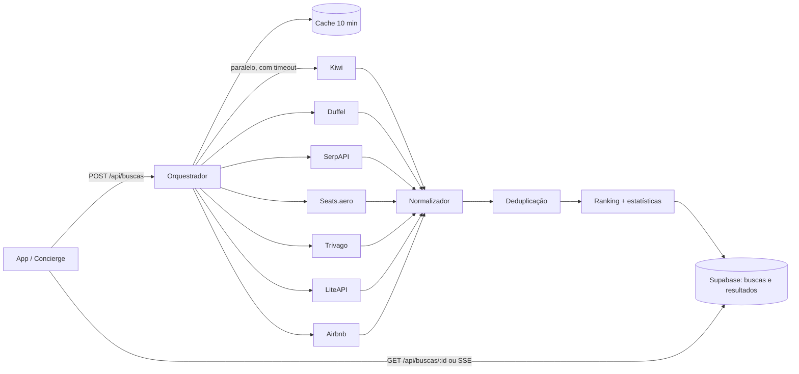

# Projeto: Buscador do Concierge

Versão 0.1 · 2026-11-01 · Base: [pesquisa Skyscanner](pesquisas/skyscanner-busca-de-voos.md) e [pesquisa Trivago](pesquisas/trivago-busca-de-hoteis.md)

Um buscador único de **voos (dinheiro e milhas)** e **hospedagem (hotéis e Airbnb)**, que o viajante usa diretamente e que o agente Concierge usa como ferramenta.

## 1. Princípios

1. **Rápido primeiro, completo depois.** Mostrar resultados em 1–2 s (cache) e completar enquanto as fontes respondem (padrão criar → consultar do Skyscanner e da Duffel).
2. **Um item, vários preços.** Um voo ou hotel aparece uma vez, com todos os vendedores e preços.
3. **Custo real em R$.** O preço principal é o total da viagem: com bagagem (quando o viajante precisa), taxas e todas as noites. Milhas são convertidas em custo efetivo.
4. **Ranking imparcial e explicável.** Comissão nunca muda posição. Cada resultado "Melhor" mostra o porquê.
5. **Só fontes oficiais ou licenciadas.** Nada de APIs privadas, raspagem que viole termos ou contorno de proteções.

## 2. Fontes de dados

### Voos em dinheiro

| Fonte | Acesso | Papel | Observações |
|-------|--------|-------|-------------|
| Kiwi.com | MCP, sem chave | Busca principal no MVP | Datas ±3 dias, link de compra; poucos dezenas de resultados por busca |
| Duffel | API, `DUFFEL_API_KEY` | Preço real por classe tarifária; reserva no futuro | Busca em lotes: cria, recebe `id` e consulta até `remaining_batches = 0`; `supplier_timeout` 2–60 s (padrão 20 s) |
| Google Flights (SerpAPI) | API, `SERPAPI_API_KEY` | Calendário de preços e descoberta | Preço tende a vir acima do real; usar como indicativo |
| Skiplagged | MCP, sem chave | Opcional | Só exibir "hidden city" com aviso de risco |

### Voos com milhas

| Fonte | Acesso | Cobertura | Observações |
|-------|--------|-----------|-------------|
| Seats.aero | API, `SEATS_AERO_API_KEY` (cabeçalho `Partner-Authorization`) | Programas estrangeiros, entre eles Aeroplan, LifeMiles, United, American, Delta, Alaska, Virgin Atlantic, Emirates, Etihad, Qantas, Velocity e Aeromexico (conferir a lista atual na documentação) | Plano Pro: 1.000 chamadas/dia, **só uso pessoal e não comercial**, só busca em cache. Uso comercial e busca ao vivo exigem aprovação por escrito |
| Smiles, LATAM Pass, Azul Fidelidade | **Sem API pública** | Programas brasileiros | O Seats.aero não cobre LATAM Pass diretamente (e não menciona Smiles nem Azul). Ver seção 6 |

### Hospedagem

| Fonte | Acesso | Papel | Observações |
|-------|--------|-------|-------------|
| Trivago | MCP, sem chave | Descoberta e preços por site | Busca por cidade e por raio de coordenadas |
| LiteAPI | MCP/API, `LITEAPI_API_KEY` | Tarifa ao vivo e **reserva** (pré-reserva → reserva) | Tem sandbox; fonte de receita por comissão |
| Airbnb | MCP comunitário `@openbnb/mcp-server-airbnb` | Aluguel por temporada | **Não oficial**: lê o site público, respeita robots.txt por padrão. Bom para protótipo; ver riscos (seção 11) |

## 3. Arquitetura



- **Adaptadores** (um por fonte) transformam a resposta da fonte no modelo único (seção 4). Falha ou falta de chave em um adaptador não derruba a busca.
- **Orquestrador** dispara todos os adaptadores em paralelo, cada um com tempo-limite (padrão 20 s), e grava resultados à medida que chegam.
- **Normalizador → Deduplicação → Ranking** rodam a cada lote novo.
- **Stack sugerida** (Fase 2 do roadmap): Next.js na Vercel (rotas de API + front), Supabase (Postgres, autenticação, Realtime para enviar os lotes), cliente MCP no servidor para Kiwi/Trivago/Airbnb.

### API do buscador

| Método | Rota | Descrição |
|--------|------|-----------|
| `POST` | `/api/buscas` | Cria a busca. Devolve `buscaId` e os resultados já em cache |
| `GET` | `/api/buscas/{buscaId}` | Estado atual: `status` (`em_andamento` / `concluida` / `parcial`), resultados, estatísticas, fontes que falharam |
| `GET` | `/api/buscas/{buscaId}/eventos` | Stream (SSE) com cada lote novo |
| `POST` | `/api/ofertas/{ofertaId}/reconfirmar` | Busca o preço atualizado antes da compra (equivale ao "refresh" do Skyscanner) |
| `GET` | `/api/calendario` | Menor preço por dia (indicativo) para datas flexíveis |

A busca expira em 1 hora; depois disso, o app cria outra.

## 4. Modelo de dados

```ts
// Pedido
type PedidoBusca = {
  tipo: "voos" | "hospedagem" | "pacote";
  voos?: {
    trechos: { origem: string; destino: string; data: string }[]; // IATA ou cidade; data AAAA-MM-DD
    flexibilidadeDias?: 0 | 1 | 2 | 3;
    aeroportosProximos?: boolean;
    cabine: "economica" | "premium" | "executiva" | "primeira";
    soDiretos?: boolean;
    precisaBagagemDespachada?: boolean;
    incluirMilhas?: boolean;
    programas?: string[]; // ids de data/programas-fidelidade.json
  };
  hospedagem?: {
    destino: string | { lat: number; lon: number; raioKm: number };
    checkin: string; checkout: string;
    tipos?: ("hotel" | "pousada" | "apartamento" | "casa_inteira" | "quarto_privativo")[];
    incluirAirbnb?: boolean;
  };
  passageiros: { adultos: number; idadesCriancas: number[]; pets?: number };
  moeda: "BRL";
  perfil?: { pesoPreco?: number; pesoTempo?: number; pesoConforto?: number }; // ajusta o "Melhor"
};

// Voo normalizado
type Itinerario = {
  id: string;            // chave de deduplicação (seção 5)
  pernas: Perna[];       // ida, volta
  ofertas: OfertaVoo[];  // vários vendedores/preços para o mesmo voo
  pontuacao?: { melhor: number; motivos: string[] };
};
type Perna = { origem: string; destino: string; partida: string; chegada: string; duracaoMin: number; segmentos: Segmento[] };
type Segmento = { origem: string; destino: string; partida: string; chegada: string; companhia: string; operadora: string; numeroVoo: string };
type OfertaVoo = {
  fonte: "kiwi" | "duffel" | "serpapi" | "skiplagged" | "seats_aero" | "manual";
  vendedor: string;      // companhia ou agência
  tipo: "dinheiro" | "milhas";
  precoBRL?: number;     // total para todos os passageiros
  milhas?: { programa: string; quantidade: number; taxasBRL: number; caminho?: string }; // caminho: "Livelo → Smiles"
  custoEfetivoBRL: number;   // seção 6
  bagagemDespachada: "incluida" | "paga" | "desconhecida";
  linkCompra?: string;
  obtidoEm: string;      // para a regra de frescor
  avisos?: string[];     // "hidden city", "troca de aeroporto", "bilhetes separados"
};

// Hospedagem normalizada
type Hospedagem = {
  id: string; nome: string; tipo: string;
  local: { lat: number; lon: number; bairro?: string; endereco?: string };
  nota?: { valor: number; escala: 10; avaliacoes?: number };
  fotos: string[];
  ofertas: OfertaHospedagem[];
  pontuacao?: { melhor: number; motivos: string[] };
};
type OfertaHospedagem = {
  fonte: "trivago" | "liteapi" | "airbnb";
  vendedor: string;      // Booking, site do hotel, Airbnb...
  tipoQuarto: string;
  totalBRL: number;      // estadia inteira com taxas e limpeza
  porNoiteBRL: number;
  cancelamentoGratisAte?: string;
  cafeIncluido?: boolean;
  linkReserva?: string;
  obtidoEm: string;
};
```

## 5. Deduplicação

- **Voos:** a chave é a sequência de `numeroVoo + data de partida` de todos os segmentos. Mesmo voo vindo de Kiwi e Duffel vira **um** itinerário com duas ofertas.
- **Hotéis:** mesmo nome normalizado (sem acentos e sem palavras como "Hotel") e distância menor que 150 m. Airbnb nunca é fundido com hotel.
- Em empate de oferta, prevalece a fonte mais confiável: site da companhia/Duffel > Kiwi > SerpAPI (regra de `skills/licoes-aprendidas`).

## 6. Milhas no mesmo ranking que dinheiro

**Custo efetivo de uma emissão:**

```
custoEfetivoBRL = taxasBRL + (milhas ÷ 1.000) × custoDoMilheiroBRL(programa)
```

- `custoDoMilheiroBRL` = quanto custa repor 1.000 milhas daquele programa hoje (`data/programas-fidelidade.json`, campo `milheiro_referencia_brl`, com data). O viajante pode informar o próprio custo.
- Com isso, voo pago e voo por milhas são comparados na **mesma** lista.
- Para cada emissão também mostramos o **valor do milheiro obtido** = (preço em dinheiro do mesmo voo − taxas) ÷ (milhas ÷ 1.000). Se for maior que o custo de reposição, a emissão vale a pena.
- **Saldo efetivo** = saldo direto + o que dá para transferir de Livelo/Esfera (paridade e bônus vigentes). A emissão é marcada "você consegue emitir" ou "faltam X milhas".

**Programas brasileiros (Smiles, LATAM Pass, Azul Fidelidade):**
- **Fase 1:** cotação **manual** registrada pelo consultor ou pelo viajante (tela "Adicionar cotação em milhas"), com data e print opcional. Entra no ranking como fonte `manual`.
- **Fase 2:** o agente Concierge orienta a consulta no site do programa, no navegador do próprio viajante e com o login dele, e registra o resultado. Nada é feito em nome do usuário sem ele ver.
- **Fase 3:** buscar parceria comercial ou fornecedor licenciado de disponibilidade de milhas brasileiras.
- Proibido: raspar ou usar APIs internas dos programas.

## 7. Ranking

### Voos

Cada critério é normalizado de 0 (melhor da lista) a 1 (pior da lista):

| Critério | Peso padrão | Cálculo |
|----------|-------------|---------|
| Custo efetivo | 0,50 | `custoEfetivoBRL` (com bagagem, se o viajante precisa) |
| Tempo total | 0,25 | soma das durações das pernas |
| Escalas | 0,10 | 0 direto, 0,5 uma escala, 1 duas ou mais |
| Incômodo | 0,10 | conexão < 1 h ou > 6 h, troca de aeroporto, voo de madrugada, bilhetes separados |
| Confiabilidade da oferta | 0,05 | fonte, idade do preço |

```
pontuacao = 10 × (1 − Σ peso × critério)   // 0 a 10, maior é melhor
```

- **Abas:** Melhor (pontuação) · Mais barato (custo efetivo) · Mais rápido (tempo total) · **Milhas** (só emissões, por custo efetivo).
- O perfil do viajante ajusta pesos (ex.: família com criança aumenta o peso de "incômodo").
- **Explicação:** os dois critérios que mais contribuíram viram texto ("R$ 310 mais barato que a média e só 1 escala").
- Empates: menor custo efetivo, depois menor tempo. Sem aleatoriedade, para o resultado ser reproduzível.

### Hospedagem

| Critério | Peso padrão |
|----------|-------------|
| Preço total da estadia | 0,40 |
| Nota das avaliações (com penalidade para poucas avaliações) | 0,25 |
| Localização (distância ao bairro recomendado ou ao ponto de interesse) | 0,25 |
| Flexibilidade (cancelamento grátis, café incluído) | 0,10 |

- A **oferta em destaque** de cada hotel é sempre a **mais barata** do mesmo tipo de quarto e mesmas condições.
- Preço riscado só quando o tipo de quarto é idêntico.
- Comissão, lance ou parceria **nunca** entram na fórmula. Patrocínio, se existir, aparece separado e rotulado.

## 8. Filtros e estatísticas

Calculados a partir dos resultados a cada lote (como o `stats` do Skyscanner):

- **Voos:** faixa de preço, escalas (direto / 1 / 2+), companhias, aeroportos, horário de partida e chegada (madrugada/manhã/tarde/noite), duração máxima, bagagem incluída, dinheiro ou milhas, programa de milhas.
- **Hospedagem:** tipo (hotel, pousada, apartamento, Airbnb casa inteira, Airbnb quarto), faixa de preço total, nota mínima, bairro, distância, cancelamento grátis, café incluído, comodidades (piscina, cozinha, estacionamento, pet).

## 9. Frescor e reconfirmação

- Resultados ficam em cache por **10 minutos** por combinação de pedido.
- Preços de calendário/datas flexíveis são **indicativos** e rotulados assim.
- Antes de enviar o viajante para comprar ou reservar, `POST /reconfirmar` busca o preço atual. Se mudou, a tela avisa a diferença.
- Toda oferta mostra "preço visto há X min".

## 10. Telas

1. **Busca:** abas Voos · Hospedagem · Pacote. Campos do pedido, chaves "datas flexíveis", "aeroportos próximos", "incluir milhas", "incluir Airbnb".
2. **Resultados de voos:** barra de progresso das fontes, abas de ordenação, filtros, cartões com custo efetivo, selo "por milhas" e explicação do "Melhor".
3. **Detalhe do voo:** pernas e conexões, bagagem, todas as ofertas (dinheiro e milhas) com vendedor, valor do milheiro e botão de compra com reconfirmação.
4. **Resultados de hospedagem:** lista + mapa, bairros recomendados no topo, filtros.
5. **Detalhe da hospedagem:** fotos, comodidades, regras, mapa, todas as ofertas por site.
6. **Pacote:** combina o melhor voo e a melhor hospedagem para o mesmo período, com total por pessoa; trocar qualquer item recalcula o total.
7. **Calendário de preços:** menor preço indicativo por dia, em dinheiro e em milhas.
8. **Cotação manual de milhas:** formulário para programas brasileiros (seção 6).

## 11. Riscos e decisões pendentes

| Risco | Impacto | Decisão proposta |
|-------|---------|------------------|
| Seats.aero Pro proíbe uso comercial | Não pode ir para clientes com chave pessoal | Usar só em testes; pedir aprovação comercial antes do lançamento |
| Programas brasileiros sem API | Sem milhas BR automáticas | Cotação manual/assistida (seção 6) e busca de parceria |
| MCP do Airbnb é comunitário e lê o site público | Pode quebrar e pode conflitar com os termos do Airbnb em uso comercial | Protótipo apenas, sem `--ignore-robots-txt`; para produção, fonte licenciada de aluguel por temporada (ex.: parceiros de distribuição de imóveis por temporada) |
| Hidden city (Skiplagged) | Viajante pode perder trechos ou ser penalizado | Desligado por padrão; aviso obrigatório |
| Termos de uso dos MCPs de Kiwi e Trivago | Uso comercial pode exigir acordo | Ler termos antes da Fase 2 |
| LGPD | Dados de viajantes e documentos | Consentimento, mínimo necessário, criptografia no Supabase |

## 12. Plano de implementação

| Etapa | Entregas | Fontes |
|-------|----------|--------|
| 1 — MVP sem chaves | Orquestrador, modelo de dados, voos + hotéis + Airbnb, ranking, filtros, telas 1–5 | Kiwi, Trivago, Airbnb |
| 2 — Precisão | Ofertas Duffel, tarifas e reserva LiteAPI, reconfirmação, cache | Duffel, LiteAPI |
| 3 — Milhas | Seats.aero (testes), cotação manual BR, custo efetivo, aba Milhas, saldo efetivo | Seats.aero, manual |
| 4 — Flexibilidade | Calendário, pacote, aeroportos próximos | SerpAPI, Kiwi |
| 5 — Retenção | Alertas de queda de preço, buscas salvas | Todas |

O agente Concierge usa o mesmo buscador como ferramenta (`buscar_voos`, `buscar_hospedagem`), então o ranking e as regras valem igualmente no chat e no app.
